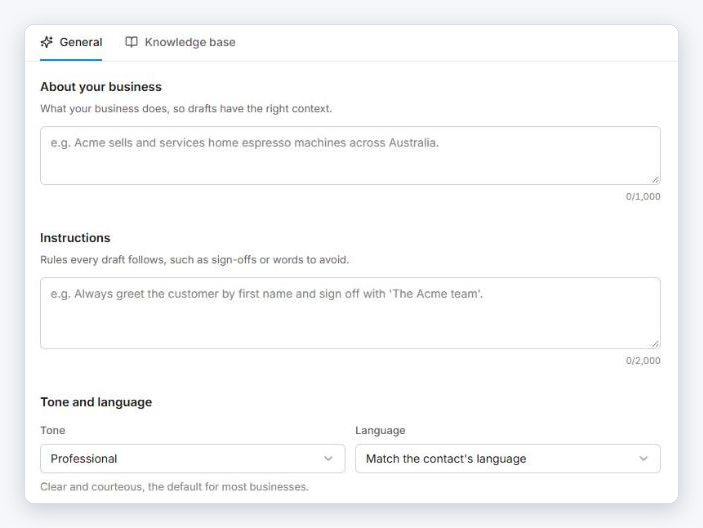
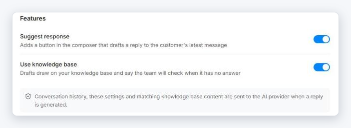
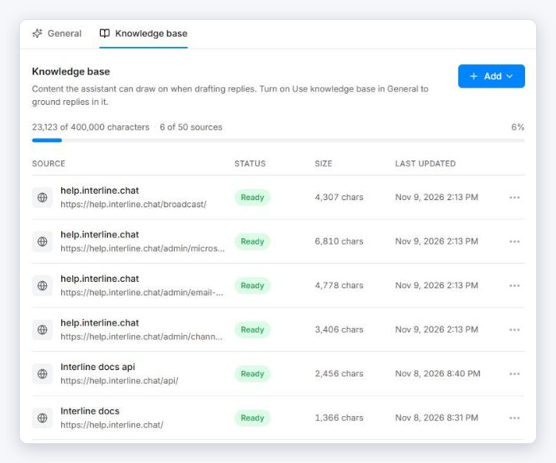

# AI Assistant

The AI Assistant helps agents write replies faster. It can **suggest a reply** to the customer's latest message, **write a draft** from a short description, and **refine** what an agent has typed. An agent always reviews and sends the message — the assistant never sends anything by itself.

Set it up in **Settings → AI Assistant**. The page has two tabs: **General** and **Knowledge base**.

## General

{ width="703" }

| Setting | What to put there |
|---------|-------------------|
| **About your business** | What your business does, in a few sentences, so drafts have the right context. Up to 1,000 characters. |
| **Instructions** | Rules every draft should follow, such as how to greet customers, how to sign off, or words to avoid. Up to 2,000 characters. |
| **Tone** | **Professional** (the default), **Friendly**, **Casual**, **Formal**, or **Empathetic**. |
| **Language** | **Match the contact's language**, or **Always reply in a fixed language** that you choose. |

Click **Save changes** when you're done.

### Features

{ width="703" }

- **Suggest response** — adds a **Suggest response** button to the composer that drafts a reply to the customer's latest message.
- **Use knowledge base** — drafts draw on your knowledge base. When the knowledge base has no answer, the draft says the team will check, instead of guessing.

!!! note "What is sent to the AI provider"
    When a reply is generated, the conversation history, these settings, and matching knowledge base content are sent to the AI provider.

## Knowledge base

The knowledge base is the content the assistant can draw on: your policies, FAQs, price lists, product details.

{ width="700" }

Click **Add** and choose a source type:

| Source | Use it for |
|--------|------------|
| **Text** | Paste policies, FAQs, or product details directly. |
| **Web page** | Enter the address of a public page. Interline fetches the page and keeps its text. |
| **File** | Upload a `.txt`, `.md`, `.csv`, `.pdf`, or `.docx` file, up to 10 MB. |

Each source shows a **status** — it's usable once it reads **Ready** — plus its size and when it was last updated. The bar at the top shows how much of your allowance is used (characters and number of sources).

Use the **⋯** menu on a source to:

- **Refresh** a web page, to pick up changes made to the page since it was added.
- **Delete** a source you no longer want the assistant to use.

!!! tip "Turn it on"
    Adding sources isn't enough by itself — switch on **Use knowledge base** in the **General** tab so replies are grounded in them.

## How agents use it

Once it's set up, agents get AI tools in the reply composer: **Suggest response**, write a draft from a description, and refine a draft (fix spelling, grammar, or tone). See [Writing with AI](../agent/reading-and-replying.md#writing-with-ai).

AI writing is also available when composing a [Broadcast](../broadcast/index.md) message.
