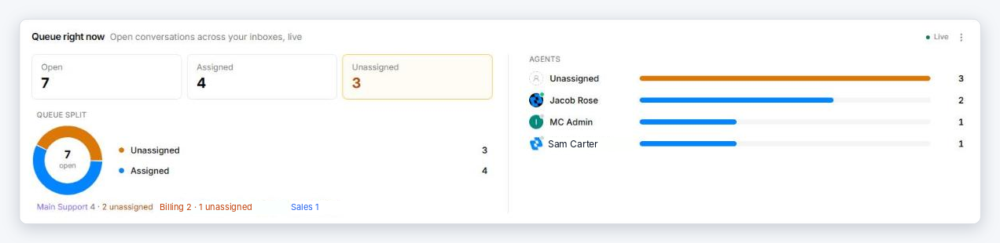
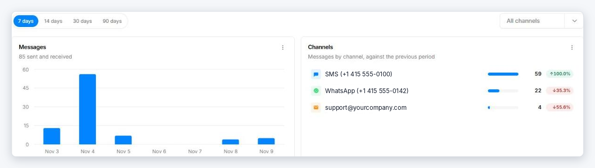

# Dashboard

The **Dashboard** is the first item in the left navigation. It answers two questions at a glance: *what is waiting right now?* and *how busy have we been?*

## Queue right now

The top card is **live** — it updates by itself as conversations open, close, and get assigned.

{ width="820" }

- **Open / Assigned / Unassigned** — how many conversations are open, and how many of those have an owner. **Unassigned** is highlighted because those are waiting for someone to pick them up.
- **Queue split** — the same numbers as a chart, with a line underneath showing how many open conversations each inbox has.
- **Agents** — open conversations per person, so you can see who is overloaded and who has room.

The counts cover the inboxes you belong to. Click **Go to Inbox** to start working on them.

## Messages and channels

Below the queue, pick a period — **7, 14, 30, or 90 days** — and optionally a single channel.

{ width="820" }

- **Messages** — messages sent and received per day.
- **Channels** — message volume for each channel, with the change against the previous period (for example the 7 days before).

Each card has a **⋮** menu with **Export** to download what the card shows.

For more detail — response times, agent performance, delivery rates — see [Reports](reports.md).
