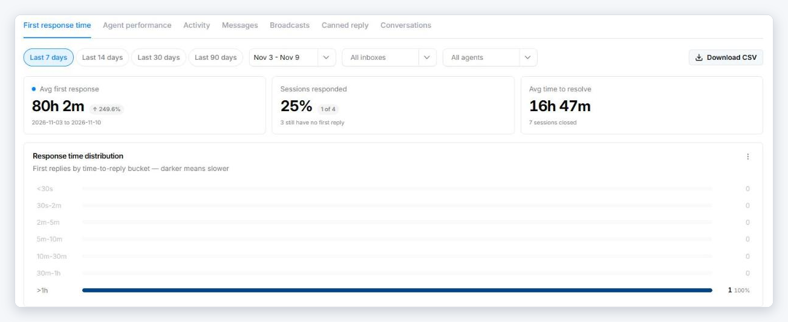
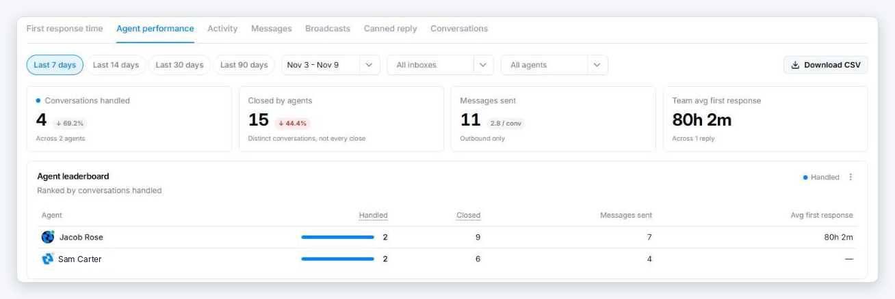

# Reports

**Reports** (left navigation) shows how your team and channels are performing over time. There are seven reports, each on its own tab.

{ width="820" }

## Filters and export

The same controls sit at the top of every report:

- **Period** — **Last 7 / 14 / 30 / 90 days**, or pick your own dates.
- **Inbox** and **Agent** — narrow the report to one inbox or one person.
- **Download CSV** — exports the report with the current filters.
- The **⋮** menu on a chart exports just that chart.

Small badges next to the headline numbers show the change against the previous period of the same length.

## The reports

| Report | What it tells you |
|--------|-------------------|
| **First response time** | How long contacts wait for a first reply: the average, the share of sessions that got a reply, the average time to resolve, a breakdown by time bucket (under 30 seconds up to over an hour), and the average per agent. |
| **Agent performance** | A leaderboard per agent: conversations handled, conversations closed, messages sent, and average first response. |
| **Activity** | Conversations created, opened, and closed per day, and which channels new conversations came in on. |
| **Messages** | Total messages, messages sent, delivery and failure rates, daily volume, where messages came from (inbound, agent replies, broadcasts, automations, API), and delivery by channel. |
| **Broadcasts** | Each campaign with its sent, delivered, failed, pending, and read counts. |
| **Canned reply** | How often canned replies are used, the most-used replies, and usage per agent. |
| **Conversations** | A filterable list of conversations with contact, inbox, status, priority, assignee, and message count. |

{ width="820" }

## Reading the numbers

- **Handled vs. closed** — *Conversations handled* counts distinct conversations an agent replied in. *Closed* counts conversations they closed, so the two can differ.
- **Opens include reopens** — in **Activity**, a conversation that is reopened counts as opened again, so one conversation can be counted more than once.
- **Delivery depends on the channel** — not every channel reports delivery receipts. A dash (—) means the channel doesn't report that figure, not that nothing was delivered.
- **Broadcasts** count messages actually sent, not the number of recipients queued. A scheduled campaign shows up in the period it was created.
- **Canned reply** usage is counted from when an agent inserts a canned reply in the composer.

For a live view of the current queue, see the [Dashboard](dashboard.md).
