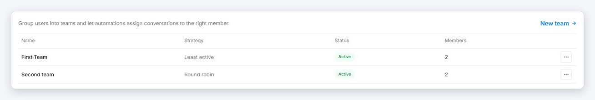
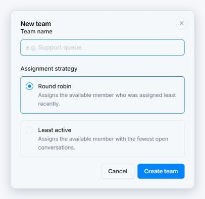
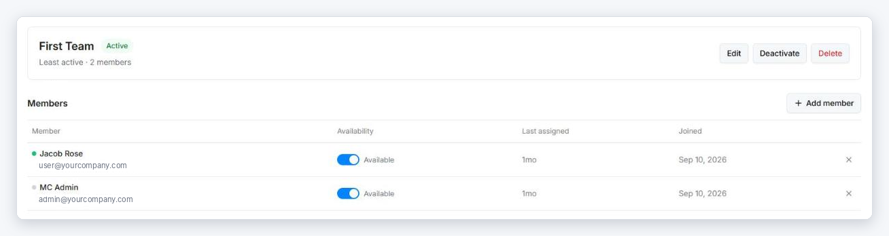

# Teams

A **team** is a group of users that automations can assign conversations to. Instead of routing every new conversation to one person, you point an automation at a team and Interline picks a member for you.

Teams are different from [inboxes](inboxes.md): an inbox decides **who can see** a conversation, a team decides **who gets assigned** to it.

Manage teams in **Settings → Teams**.

{ width="820" }

## Create a team

1. Go to **Settings → Teams** and click **New team**.
2. Enter a **Team name**, for example *Support queue*.
3. Choose the **Assignment strategy**:
    - **Round robin** — assigns the available member who was assigned least recently, so conversations are handed out in turn.
    - **Least active** — assigns the available member with the fewest open conversations, so work goes to whoever has the lightest load.
4. Click **Create team**.

{ width="406" }

## Add and remove members

Click a team to open it.

- **Add member** — search for a user and add them. Only active users in your workspace can be added.
- **Remove** — click the **×** at the end of a member's row. Conversations already assigned to them stay assigned.

{ width="820" }

## Availability

Each member has an **Availability** toggle on the team page:

- **Available** — the member is included when the team assigns a conversation.
- **Busy** — the member is skipped. Use this for holidays, breaks, or when someone is covering other work.

Availability is set per team, so someone can be available in one team and busy in another. The **Last assigned** column shows when the team last gave each member a conversation.

!!! note "If nobody is available"
    When every member is set to **Busy**, the team has nobody to assign to, and conversations stay unassigned.

## Use a team in an automation

Teams do nothing on their own — an automation has to assign to them. In [Automation](automation.md), create an **Assign or unassign** automation and choose the team as the assignee. Each matching conversation is then given to one team member according to the team's strategy.

## Edit, deactivate, or delete a team

Open the team, or use the **⋯** menu in the Teams list:

- **Edit** — change the name or the assignment strategy.
- **Deactivate** — pause the team without losing its members. An inactive team assigns nobody: automations that point to it leave conversations unassigned. **Activate** turns it back on.
- **Delete** — removes the team and takes all members off it. Conversations already assigned to members stay assigned.

!!! warning "Check your automations first"
    Before you deactivate or delete a team, update any automation that assigns to it — otherwise new conversations matching that automation won't be assigned to anyone.
