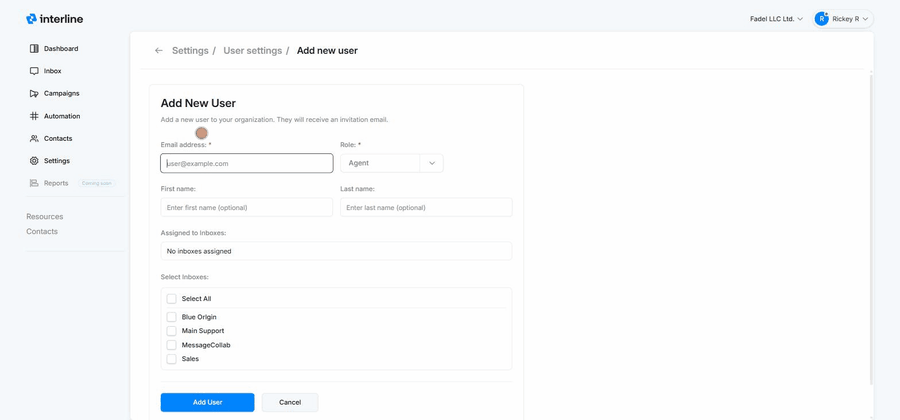
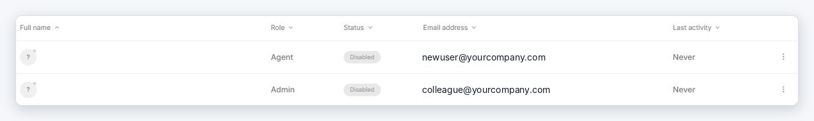
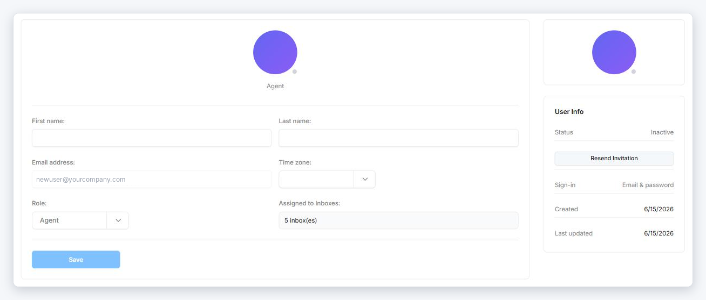

# Users & Roles

Your team members are managed under **Settings → User Management**. From here you add people, set their role, control which inboxes they can see, and enable or disable accounts.

## The user list

The overview shows your **total users** and how many **inboxes** exist. Below it, a searchable table lists every user with their **name**, **role**, **status** (Active or Disabled), **email address**, and **last activity**. You can search by name and filter by role.

Each user's row menu (**⋯**) lets you edit them, change their role or inbox access, and disable or re-enable the account. **Disabling** a user keeps their history but blocks them from signing in — use it instead of deleting when someone leaves.

## Adding a user

1. Go to **Settings → User Management** and click **Add user**.
2. Enter the user's **email address** (required) — this is where their invitation is sent.
3. Choose a **role** (required). See [roles](#roles) below.
4. Optionally add a **first** and **last name** (they can also set these themselves on first sign-in).
5. Under **Select Inboxes**, tick the inboxes this user should have access to (or **Select All**). A user only sees conversations in the inboxes assigned to them — plus anything assigned directly to them (see [Mailboxes & Inboxes](../agent/mailboxes.md)).
6. Click **Add User**. They'll receive an **invitation email** with a link to activate their account — see [Invitations](#invitations) below.

{ width="760" }

!!! tip "Inbox access matters"
    Assigning the right inboxes is how you scope what each agent sees. An agent on only the *Sales* inbox won't see *Support* conversations — but if a *Support* conversation is assigned to them, it still shows up under their **Assigned to me**.

## Invitations

A new user can't sign in until they **accept their invitation**. Here's how it works:

1. When you add a user, Interline emails them an invitation with an **Accept Invitation** link.
2. The user opens the link, enters their name, and **sets a password** (or continues with Google).
3. Their account is activated and they're signed in.

!!! warning "The invitation link expires after 7 days"
    If the user doesn't accept within 7 days, the link stops working and shows **Invalid Invitation**. An admin or manager has to [resend the invitation](#resend-an-invitation) — the user can't request a new one themselves.

### Before the invitation is accepted

Until the user accepts, their account isn't active:

- In the user list they show as **Disabled**, with no name and **Last activity: Never**. On the user's own page the status reads **Inactive**.
- They **can't sign in**.
- They **can't reset their password**. If they try **Forgot password**, they get an email saying the account isn't active yet instead of a reset link. The invitation link is the only way to set the first password.

{ width="820" }

Once they accept, the status changes to **Active**.

### Resend an invitation

If an invitation expired, was lost, or went to spam:

1. Go to **Settings → User Management** and click the user.
2. In the **User Info** panel on the right, click **Resend Invitation**.

{ width="820" }

The user gets a new email with a new link, valid for another 7 days. Earlier links aren't needed any more — tell them to use the newest email.

**Who can resend:** admins can resend for anyone. Managers can resend for agents and other managers, but not for admins.

!!! tip "Invited the wrong address?"
    The email address can't be changed on an invitation. Remove the user from their row menu (**⋮** → **Delete**) and add them again with the right address.

## Roles

Interline uses role-based access. The roles are:

- **Admin** — full access, including settings, channels, billing, users, and all inboxes.
- **Manager** — manages day-to-day operations and team workflows (broader than an agent, without full admin control).
- **Agent** — front-line conversation handling in the inboxes they're assigned to.

Set a user's role when you add them, and change it later from their row menu. Pick the least-privileged role that lets someone do their job — most conversation handlers are **Agents**.

!!! note "Role permissions"
    Fine-grained permission configuration per role is part of the platform's RBAC model and will be expanded in these docs. For now, choose Admin / Manager / Agent based on the access summary above.
