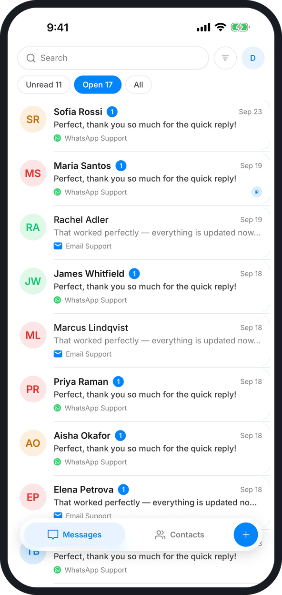
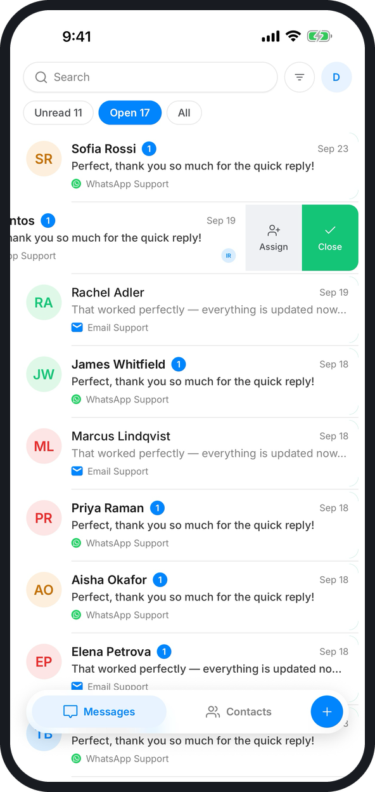
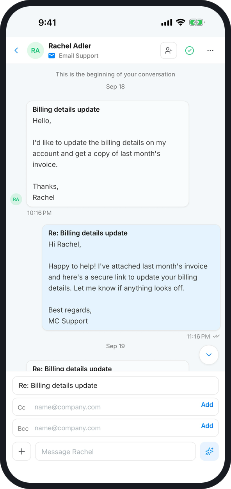
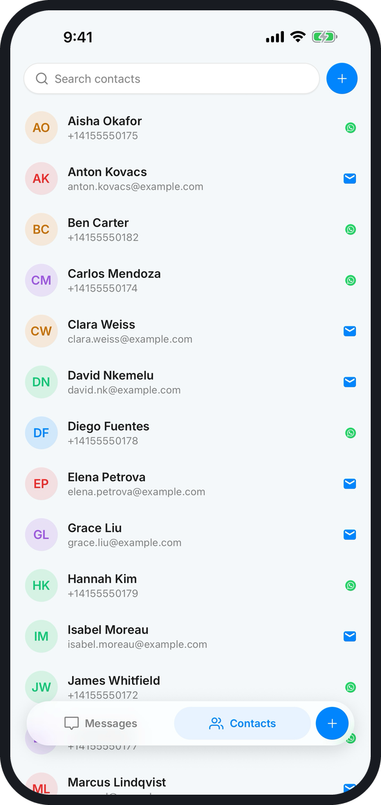

# Mobile & Desktop Apps

Interline runs in any browser, and you can also use it as an app on your phone and on your computer. Every app signs in to the same workspace, so conversations, assignments, and contacts stay in sync everywhere.

-   :fontawesome-brands-apple:{ .lg .middle } **iPhone & iPad**

    ---

    Interline Inbox, free on the App Store.

    [{ width="150" .off-glb }](https://apps.apple.com/us/app/interline-inbox/id6807936568){ target="_blank" rel="noopener" }

-   :fontawesome-brands-android:{ .lg .middle } **Android**

    ---

    Interline, free on Google Play.

    [{ width="190" .off-glb }](https://play.google.com/store/apps/details?id=chat.interline.app){ target="_blank" rel="noopener" }

-   :material-monitor:{ .lg .middle } **Windows & Mac**

    ---

    Install Interline as a desktop app from Chrome or Edge.

    [:material-download: How to install](#desktop-app){ .md-button }

## Mobile app

The mobile app is built for handling conversations away from your desk: read and reply, assign, close, and get a push notification when something needs you.

{ width="165" }
{ width="165" }
{ width="165" }
{ width="165" }

### Sign in

1. Install the app from the App Store or Google Play.
2. Sign in with the **email address and password** you use for Interline on the web.
3. Allow notifications when asked, so new messages reach you.

!!! note "Google sign-in is Android only"
    On Android you can also tap **Sign in with Google**. The iPhone and iPad app doesn't have Google sign-in — use your email address and password there. If you normally sign in with Google on the web and don't have a password, set one with **Forgot password** on the web sign-in page first.

!!! note "No sign-up in the app"
    Accounts are created by your workspace admin. If you don't have one yet, ask your admin to [invite you](admin/users-roles.md).

### What you can do

| | |
|---|---|
| **Inbox** | Conversations from SMS, WhatsApp, and email in one list, updated in real time. Switch between **Unread**, **Open**, and **All**, search, and filter by status, channel, inbox, or assignee. |
| **Reply** | Send messages, photos, and files, use canned replies and WhatsApp templates, and draft replies with AI. |
| **Assign and close** | Swipe a conversation in the list to assign or close it, or use the buttons at the top of a conversation. |
| **New conversation** | Tap **+** to message a contact on any channel they use. |
| **Contacts** | Browse, add, and edit the shared contact directory. |
| **Organizations** | If you belong to more than one workspace, switch between them in Settings. |

Admin tasks — channels, users, automation, campaigns, reports — are done in the web or desktop app.

### Notifications and settings

Tap your **avatar** at the top of the inbox to open **Settings**. From there you can turn **Push notifications** on or off, choose a light or dark **Appearance**, **Switch organization**, and **Log out**.

!!! tip "Not getting push notifications?"
    Check that notifications are allowed for Interline in your phone's settings, then open **Settings** in the app and make sure **Push notifications** is on.

## Desktop app

The desktop app is the full Interline web app, installed on your computer from **Google Chrome** or **Microsoft Edge**. There's nothing to download from a store — the browser installs it in a few seconds.

Why install it:

- **Its own window** — Interline opens without tabs or an address bar, so it doesn't get lost among your browser tabs.
- **Its own icon** — pin it to the taskbar, Start menu, or dock and open it like any other program.
- **Notifications** — [desktop notifications](agent/notifications.md) show the Interline name and icon.
- **Always current** — it updates itself, just like the website. There's nothing to maintain.

Everything works the same as in the browser, and you stay signed in.

### Install

When you open Interline in Chrome or Edge, the browser shows an **install button at the right end of the address bar** — :material-monitor-arrow-down-variant:{ .middle } in Chrome, :material-view-grid-plus-outline:{ .middle } in Edge.

=== "Microsoft Edge"

    1. Open [app.interline.chat](https://app.interline.chat){ target="_blank" rel="noopener" } in Edge and sign in.
    2. Click the **App available** icon :material-view-grid-plus-outline:{ .lg .middle } at the right end of the address bar. You can also open the **⋯** menu → **Apps** → **Install Interline**.
    3. Click **Install**.
    4. Edge then asks where you want it: tick **Pin to taskbar**, **Pin to Start**, or **Create Desktop shortcut**, and optionally **Auto-start on device login**. Click **Allow**.

=== "Google Chrome"

    1. Open [app.interline.chat](https://app.interline.chat){ target="_blank" rel="noopener" } in Chrome and sign in.
    2. Click the **Install** icon :material-monitor-arrow-down-variant:{ .lg .middle } at the right end of the address bar. You can also open the **⋮** menu → **Cast, save, and share** → **Install page as app**.
    3. Click **Install**.

Interline opens in its own window right away. On Windows it also appears in the Start menu; on a Mac it's added to Launchpad and the Applications folder.

### Pin it and turn on notifications

- **Windows** — right-click the Interline icon on the taskbar while it's open and choose **Pin to taskbar**.
- **Mac** — right-click the icon in the Dock → **Options** → **Keep in Dock**.
- **Notifications** — the first time, your browser asks whether Interline may send notifications. Click **Allow**, then choose what you're notified about in [Notifications](agent/notifications.md).

### Uninstall

Open the desktop app, click the **⋯** (Edge) or **⋮** (Chrome) menu in its title bar, and choose **App settings** → **Uninstall**, or **Uninstall Interline**. This only removes the app from your computer — your account and conversations aren't affected.

### Troubleshooting

??? info "I don't see the install button"
    - Use **Chrome** or **Edge**. Other browsers, such as Firefox, don't offer the install button.
    - Private (InPrivate / Incognito) windows can't install apps — use a normal window.
    - If Interline is already installed, the address bar shows **Open in app** instead.

??? info "The desktop app doesn't show notifications"
    Check that notifications are allowed for Interline in the browser you installed it from, and that Windows or macOS notifications are turned on for that browser. See [Notifications](agent/notifications.md).
