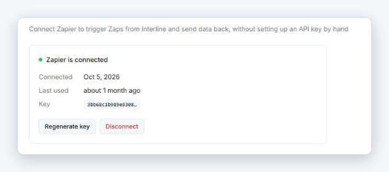

# Zapier

[Zapier](https://zapier.com/apps/interline/integrations){ target="_blank" rel="noopener" } connects Interline to thousands of other apps without code. A **Zap** is an automated workflow: something happens in one app (the *trigger*), and Zapier does something in another (the *action*).

Typical uses:

- A new lead fills in a form → create the contact in Interline and send a welcome SMS.
- A customer texts in → add a row to a spreadsheet or create a ticket in your CRM.
- An order ships in your store → send the customer a WhatsApp update.

!!! note "You need a Zapier account"
    Zapier is a separate service with its own plans, including a free tier. The Interline app on Zapier is currently marked **Beta**.

## Connect Interline to Zapier

Only **admins** can connect or disconnect Zapier.

1. In Interline, go to [**Settings → Integrations**](https://app.interline.chat/settings/api){ target="_blank" rel="noopener" } and open the **Zapier** tab.
2. Click **Connect Zapier**. Interline creates a key for Zapier and shows it once.
3. **Copy the key**, then click **I've saved the key**.
4. In Zapier, create a Zap and pick **Interline** as the trigger or action app.
5. When Zapier asks you to sign in, paste the key into the **API Key** field and continue.

{ width="634" }

!!! warning "The key is shown only once"
    Copy the key before closing the box — Interline never shows the full key again. If you lose it, use **Regenerate key** and paste the new one into Zapier.

Once connected, the tab shows **Zapier is connected**, the date it was connected, when it was last used, and the start of the key.

## Triggers

Triggers start a Zap when something happens in Interline. Both are instant.

| Trigger | Fires when | Options |
|---------|------------|---------|
| **New Incoming Message** | A contact sends a message to any of your channels. | Limit it to one **Channel** (optional). |
| **New Contact** | A new contact is created in Interline. | — |

**New Incoming Message** passes along the message text, subject (email), the contact's ID and phone number, the channel, the conversation ID, whether it started a new conversation, and whether it has attachments.

## Actions

Actions let a Zap do something in Interline.

| Action | What it does |
|--------|--------------|
| **Send Message** | Sends a message to a contact from the **Channel** you choose. Add a subject for email, attachment links, or a WhatsApp **Message Template**. |
| **Create Contact** | Creates a new contact. First name is required. |
| **Update Contact** | Updates an existing contact. Only the fields you fill in are changed. |
| **Find Contact** | Looks up a contact by phone number or email. Can create the contact if none is found (**Find or Create Contact**). |
| **Assign Conversation** | Assigns a conversation to a team member. |
| **Unassign Conversation** | Removes the assignee from a conversation. |
| **Open Conversation** | Reopens a conversation. |
| **Close Conversation** | Closes a conversation. |

!!! tip "Phone numbers"
    Use international format, for example `+14155550123`.

!!! note "WhatsApp and the 24-hour window"
    To message a WhatsApp contact who hasn't written to you in the last 24 hours, **Send Message** needs an approved **Message Template**. Free-text messages only go through inside the 24-hour window.

## Regenerate the key or disconnect

On the **Zapier** tab:

- **Regenerate key** replaces the key. Zaps using the old key stop working until you paste the new key into your Interline connection in Zapier.
- **Disconnect** removes Zapier's key and every webhook Zapier created. Your Zaps stop triggering until you connect again.

## Troubleshooting

??? info "Zapier says the API key is invalid"
    The key was probably regenerated or Zapier was disconnected. Open the **Zapier** tab, regenerate the key, and reconnect your Interline account in Zapier with the new key.

??? info "A Zap doesn't trigger on new messages"
    Check that the Zap is switched on in Zapier, and that its **Channel** option (if set) matches the channel the message arrived on. The trigger fires for incoming messages only, not for messages your team sends.

??? info "I don't see the Connect Zapier button"
    Only admins can manage Zapier. Ask an admin in your workspace to connect it.

Building your own integration instead? See the [API overview](../api/index.md) and [Webhooks](../api/webhooks.md).
